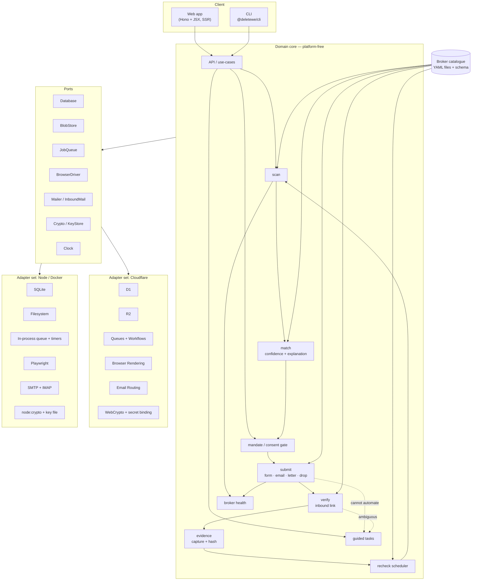
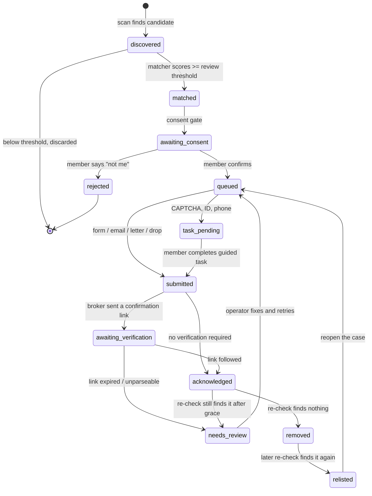

# Architecture

## 1. Shape

`deletewe` is a **hexagonal (ports-and-adapters) core** with two deployment
targets that share 100% of the domain logic:

- **Hosted** — Cloudflare Workers, D1, R2, Queues, Workflows, Browser Rendering,
  Email Routing.
- **Self-hosted** — a single Node process in Docker, with SQLite, the local
  filesystem, an in-process queue, Playwright, and SMTP/IMAP.

The engine never imports a platform SDK. It depends only on port interfaces
defined in `@deletewe/engine/ports`. Rationale in
[adr/0001-ports-and-adapters.md](adr/0001-ports-and-adapters.md) and
[adr/0002-cloudflare-platform.md](adr/0002-cloudflare-platform.md).

## 2. System diagram



## 3. The pipeline



Every transition writes an `event` row and, where an external interaction
occurred, an `evidence` row.

## 4. Jobs and durability

A **job** is one attempt at one stage for one listing. Jobs are durable,
idempotent (keyed on `idempotency_key`), retried with exponential backoff, and
capped.

Two kinds of waiting, handled differently:

| Wait | Duration | Hosted | Self-hosted |
| --- | --- | --- | --- |
| Retry backoff | seconds–hours | Queue delay | Timer in the scheduler table |
| Verification window | ~24h | Workflow sleep | Scheduler table, polled |
| Re-check interval | 30–365 days | Scheduler table + cron | Scheduler table + cron |

Long waits are **never** held in memory or in a queue-delay — they live as rows
in `scheduled_job` with a `run_after` timestamp, swept by a cron tick. This is
the one design decision that makes a quarterly product survive a deploy.

## 5. Politeness and rate limiting

Per-broker limits come from the broker definition:

```yaml
rate_limit:
  max_concurrent: 2
  min_interval_ms: 2000
  daily_cap: 500
```

Enforced centrally in the dispatcher, not per worker. A broker that returns 429
or a block page trips a circuit breaker and marks the definition
`degraded`.

**We identify ourselves.** Outbound requests carry a descriptive User-Agent
naming the project and linking to the repo. We are acting as someone's
authorized agent exercising a statutory right; there is no reason to hide, and
pretending to be a browser we are not would undercut the legal posture.

## 6. Matching

The matcher is pure, deterministic, and testable in isolation — no I/O.

```
score = Σ (field_weight × field_similarity) / Σ field_weight
```

with per-field comparators: normalised name (with nickname expansion),
address (USPS-style normalisation, separate locality/region/postal weights),
phone (E.164), email (local-part + domain), age/DOB (tolerance window).

The broker definition supplies `match.fields` weights, because brokers expose
different fields. Output is a `MatchResult` carrying the score **and** an
array of `{field, profileValue, listingValue, similarity, weight}` so the
member's review screen can explain itself. An unexplainable match is not
offered to the member.

Thresholds are per-broker with global defaults. `require_manual_confirmation:
true` on a definition forces review regardless of score — used where the broker
penalises bad requests or where listings are known to be ambiguous.

## 7. Evidence

```
evidence/
  {member_id}/{listing_id}/{job_id}/
    screenshot.png       # when a browser was used
    page.html            # sanitised DOM snapshot
    transcript.json      # request/response metadata, no bodies with secrets
    meta.json            # sha256 of each artefact, timestamps, engine version
```

Write-once: the blob key includes the job id, and the store refuses overwrite.
`meta.json` carries the SHA-256 of every sibling artefact, so a bundle can be
checked for tampering after export. Blobs are encrypted at rest with the
member's data key.

## 8. Broker health

The failure mode that kills services like this is a broker changing its page so
a step script stops working — which from the outside looks identical to a
broker ignoring the request.

So every step declares an expectation:

```yaml
- action: click
  selector: "#optout-submit"
  expect: { selector_present: "#optout-submit" }
```

A run that fails an `expect` does **not** record a failed opt-out. It records a
**health incident** against the broker definition, flips its status to
`broken`, pauses dispatch for that broker, and raises an operator item. Members
see "we can't currently reach this broker", not a false "we asked and they
refused".

Health status is computed from a rolling window of runs and is a published
field on the catalogue.

## 9. Security architecture

| Concern | Mechanism |
| --- | --- |
| PII at rest | Envelope encryption: per-member DEK (AES-256-GCM) wrapped by a master key held in a secret binding / key file. Ciphertext in the DB; plaintext never persisted |
| Encrypted columns | `name`, `address`, `phone`, `email`, `dob`, evidence blobs |
| Searchability | Blind indexes (HMAC of normalised value) for equality lookup without decryption |
| Key rotation | DEKs rewrapped without touching ciphertext; master key versioned |
| PII in logs | A redacting logger that strips known PII shapes; a unit test asserts no profile field reaches the sink |
| Secrets | Platform secret bindings; never in the repo; `.dev.vars` gitignored |
| Session | HttpOnly, Secure, SameSite=Lax cookies; server-side session rows; rotation on privilege change |
| Outbound | Allowlist: a browser job may only navigate to hosts declared by the broker definition |
| Admin | Separate role, separate audit log, no access to decrypted member PII except via an explicitly-logged break-glass path |

Full analysis in [threat-model.md](threat-model.md).

## 10. Repository layout

```
packages/
  schema/        Broker-definition schema (Zod) + generated JSON Schema + types
  catalog/       Broker YAML files, loader, validator, health metadata
  engine/        Domain core: ports, pipeline, matcher, dispatchers, crypto
  adapters-cf/   Cloudflare adapters (D1, R2, Queues, Browser Rendering, Email)
  adapters-node/ Node adapters (SQLite, fs, in-proc queue, Playwright, SMTP)
  cli/           Self-hoster CLI
apps/
  worker/        Cloudflare Worker: HTTP API, web UI, queue consumers, cron
  selfhost/      Node entrypoint for Docker
  mock-broker/   Mock broker server used by e2e tests
docs/            Specs, research, ADRs, playbook
```

## 11. California DROP

DROP is the statutory channel: one request reaches every registered data
broker, and since 1 August 2026 brokers must retrieve it at least every 45
days. For a California resident that is both free and stronger than anything
we can do broker-by-broker, so the dashboard promotes it rather than burying
it ([research](research/05-legal-basis.md)).

**Submission is a member action, by law rather than by our choice.** The
regulations (Cal. Code Regs. tit. 11) are explicit:

| Section | Effect on the design |
| --- | --- |
| § 7620(a) | "Consumers must submit their deletion request through the DROP", after the Agency verifies California residency via the California Identity Gateway or Login.gov. A government identity check no agent can pass for them. |
| § 7621(a) | An authorized agent may "aid in" a deletion request — aid, not make. |
| § 7621(b) | The agent's full name, email, and trade name (if a business) must be in the consumer's DROP account **before** submission. |
| § 7621(c) | An agent may not cancel a request unless expressly directed by the consumer. |
| § 7620(d) | No amendment or cancellation for the first 45 days. |
| § 7616(c) | A data broker must not contact a consumer to verify a DROP request. |
| §§ 7610–7613 | The DROP **API** is the data-broker side: an account with an EIN, an access fee, and retrieval of hashed deletion lists. A removal agent must not occupy that role. |

So the integration is a **guided statutory channel with a tracked clock**:

```
 member marks eligible ──> GuidedDropChannel.submit()
                             │
                             └─> member_action_required
                                   │  ordered steps + our agent disclosure
                                   ▼
                             guided task ──> member submits at the portal
                                               │
                                               ▼
                                   recordDropSubmission()
                                     stores reference (encrypted),
                                     starts the statutory timeline,
                                     schedules the 45-day re-check
```

`GuidedDropChannel` returns `member_action_required`, never a fabricated
success. `ApiDropChannel` is the empty seam should CalPrivacy ever publish an
agent submission interface; it is deliberately not implemented against a
guessed endpoint.

The timeline lives in `drop_request`, not in a case, because it has its own
statutory lifecycle. `packages/engine/src/drop.ts` carries the citations next
to the constants they justify, so a future change to the regulations has an
obvious place to land.

## 12. What is deliberately absent

- No CAPTCHA-solving service, and no port for one.
- No third-party analytics, session replay, or error reporter that could receive
  PII.
- No ML model training on member data.
- No shared index across members; every query is member-scoped at the data
  layer, not by convention.
