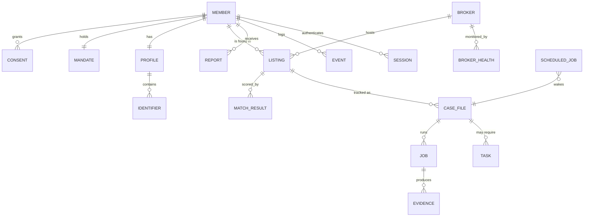

# Data model

Portable SQL, targeting both **D1** (hosted) and **SQLite** (self-host). One
migration set, applied by both.

Conventions:
- ids are ULIDs (`TEXT`, lexicographically sortable, no coordination needed);
- timestamps are `INTEGER` epoch-milliseconds UTC;
- every table holding personal data stores **ciphertext** in `*_enc` columns and
  an optional **blind index** in `*_bidx` for equality lookup;
- every member-scoped table carries `member_id` and is queried with it, always.

## Entity relationships



## Tables

### `member`
| Column | Type | Notes |
| --- | --- | --- |
| `id` | TEXT PK | ULID |
| `email_enc` | BLOB | login email, encrypted |
| `email_bidx` | TEXT UNIQUE | HMAC for login lookup |
| `password_hash` | TEXT | scrypt/argon2 |
| `dek_wrapped` | BLOB | member data key, wrapped by master key |
| `dek_key_version` | INTEGER | for rotation |
| `jurisdiction` | TEXT | `US-CA`, `US-TX`, `GB`, `EU`, … |
| `status` | TEXT | `active` \| `paused` \| `deleting` |
| `auto_confirm_threshold` | REAL | default 0.90; `1.1` disables auto-confirm |
| `created_at` / `updated_at` | INTEGER | |

### `consent`
Append-only. Never updated, never deleted while the account lives.

| Column | Type | Notes |
| --- | --- | --- |
| `id` | TEXT PK | |
| `member_id` | TEXT FK | |
| `purpose` | TEXT | `process_pii` \| `contact_brokers` \| `store_evidence` \| `email_updates` |
| `granted` | INTEGER | 1/0 |
| `document_version` | TEXT | e.g. `consent-v1` |
| `document_sha256` | TEXT | hash of the exact text shown |
| `granted_at` | INTEGER | |
| `revoked_at` | INTEGER NULL | |
| `ip_hash` / `user_agent_hash` | TEXT | hashed, for dispute resolution |

### `mandate`
The authorized-agent authority. Produced as a document; the hash is what we can
prove.

| Column | Type | Notes |
| --- | --- | --- |
| `id` | TEXT PK | |
| `member_id` | TEXT FK | |
| `kind` | TEXT | `authorized_agent` \| `limited_power_of_attorney` |
| `scope` | TEXT | JSON: allowed actions, allowed broker categories |
| `document_version` | TEXT | |
| `document_sha256` | TEXT | |
| `signature_name` | TEXT | typed legal name as signed |
| `signed_at` | INTEGER | |
| `expires_at` | INTEGER NULL | |
| `revoked_at` | INTEGER NULL | **the kill switch** — set, and dispatch halts |

### `profile` / `identifier`

`profile` is one row per member (one subject — see
[product-spec.md](product-spec.md) principle 1). `identifier` holds the
individual assertions.

`identifier`:

| Column | Type | Notes |
| --- | --- | --- |
| `id` | TEXT PK | |
| `member_id` | TEXT FK | |
| `kind` | TEXT | `name` \| `alias` \| `address` \| `phone` \| `email` \| `dob` |
| `value_enc` | BLOB | encrypted canonical JSON for the kind |
| `value_bidx` | TEXT | HMAC of the normalised value |
| `normalised_hint` | TEXT NULL | **non-identifying** coarse hint only (e.g. region code, email domain) used for routing; never a full value |
| `is_current` | INTEGER | e.g. current vs past address |
| `confidence_weight` | REAL | member can mark "I'm unsure about this one" |
| `created_at` | INTEGER | |

### `broker`
Projection of the catalogue files into the DB for joins and stats. The files are
the source of truth; this table is rebuilt on boot.

| Column | Type | Notes |
| --- | --- | --- |
| `id` | TEXT PK | slug, e.g. `spokeo` |
| `definition_version` | TEXT | semver from the file |
| `definition_sha256` | TEXT | detects drift |
| `name` / `homepage` / `category` | TEXT | |
| `automation_level` | TEXT | `automated` \| `assisted` \| `manual` \| `unsupported` |
| `opt_out_method` | TEXT | `form` \| `email` \| `letter` \| `drop` \| `account` \| `phone` |
| `relist_interval_days` | INTEGER | |
| `jurisdictions` | TEXT | JSON array |
| `status` | TEXT | `healthy` \| `degraded` \| `broken` \| `disabled` |
| `enabled` | INTEGER | |

### `listing`
A record found at a broker that may be about the member.

| Column | Type | Notes |
| --- | --- | --- |
| `id` | TEXT PK | |
| `member_id` / `broker_id` | TEXT FK | |
| `external_url_enc` | BLOB | the listing URL — itself PII |
| `external_key` | TEXT | stable broker-side id if available; part of dedup key |
| `snapshot_enc` | BLOB | extracted fields as encrypted JSON |
| `dedup_hash` | TEXT | HMAC(broker_id, external_key or normalised URL) |
| `first_seen_at` / `last_seen_at` | INTEGER | |
| `review_count` | INTEGER | times re-checked |
| `status` | TEXT | see state machine in [architecture.md](architecture.md) |

`UNIQUE(member_id, broker_id, dedup_hash)` — re-scans update, never duplicate.

### `match_result`
| Column | Type | Notes |
| --- | --- | --- |
| `id` | TEXT PK | |
| `listing_id` | TEXT FK | |
| `score` | REAL | 0.0–1.0 |
| `explanation_enc` | BLOB | per-field breakdown, encrypted (contains PII) |
| `matcher_version` | TEXT | so old decisions stay interpretable |
| `decision` | TEXT | `pending` \| `confirmed` \| `rejected` \| `auto_confirmed` |
| `decided_at` | INTEGER NULL | |
| `decided_by` | TEXT | `member` \| `auto` \| `operator` |

### `case_file`
The unit of work the member sees: "getting you off Spokeo".

| Column | Type | Notes |
| --- | --- | --- |
| `id` | TEXT PK | |
| `member_id` / `broker_id` / `listing_id` | TEXT FK | |
| `state` | TEXT | pipeline state |
| `attempt_count` | INTEGER | |
| `opened_at` / `closed_at` | INTEGER | |
| `next_check_at` | INTEGER NULL | drives re-check |
| `outcome` | TEXT NULL | `removed` \| `refused` \| `unreachable` \| `abandoned` |

### `job`
| Column | Type | Notes |
| --- | --- | --- |
| `id` | TEXT PK | |
| `case_id` | TEXT FK NULL | null for catalogue-wide jobs |
| `member_id` | TEXT FK | |
| `kind` | TEXT | `scan` \| `submit` \| `verify` \| `recheck` \| `report` |
| `idempotency_key` | TEXT UNIQUE | `kind:case:attempt` |
| `state` | TEXT | `pending` \| `running` \| `succeeded` \| `failed` \| `cancelled` |
| `attempt` / `max_attempts` | INTEGER | |
| `run_after` | INTEGER | backoff |
| `error_code` / `error_detail` | TEXT | **codes and redacted detail only** |
| `started_at` / `finished_at` | INTEGER | |

### `scheduled_job`
Durable long waits. A cron tick sweeps `run_after <= now`.

| Column | Type |
| --- | --- |
| `id` TEXT PK, `member_id` TEXT, `kind` TEXT, `payload` TEXT (JSON, no PII), `run_after` INTEGER, `claimed_at` INTEGER NULL, `claimed_by` TEXT NULL |

### `evidence`
Immutable.

| Column | Type | Notes |
| --- | --- | --- |
| `id` | TEXT PK | |
| `member_id` / `job_id` / `case_id` | TEXT FK | |
| `kind` | TEXT | `screenshot` \| `dom` \| `transcript` \| `email` \| `letter_pdf` |
| `blob_key` | TEXT | path in the blob store |
| `sha256` | TEXT | of the plaintext artefact |
| `bytes` | INTEGER | |
| `captured_at` | INTEGER | |
| `engine_version` / `definition_sha256` | TEXT | reproducibility |

No `updated_at`. There is no update path.

### `task`
Human work items. `audience` decides whose queue.

| Column | Type | Notes |
| --- | --- | --- |
| `id` | TEXT PK | |
| `member_id` / `case_id` | TEXT FK | |
| `audience` | TEXT | `member` \| `operator` |
| `kind` | TEXT | `captcha` \| `id_upload` \| `phone_call` \| `confirm_match` \| `broker_broken` \| `verify_ambiguous` |
| `title` / `instructions_md` | TEXT | no PII — values are referenced, not inlined |
| `prefill_enc` | BLOB NULL | encrypted values to paste, shown only to the member |
| `deep_link_enc` | BLOB NULL | |
| `state` | TEXT | `open` \| `done` \| `skipped` \| `expired` |
| `due_at` / `completed_at` | INTEGER | |

### `broker_health`
| Column | Type |
| --- | --- |
| `id` TEXT PK, `broker_id` TEXT, `observed_at` INTEGER, `ok` INTEGER, `failure_kind` TEXT (`selector_missing`\|`blocked`\|`timeout`\|`unexpected_page`\|`rate_limited`), `step_id` TEXT, `definition_sha256` TEXT |

Rolling aggregates drive the broker's `status`. Contains no member data — it is
publishable.

### `report`
| Column | Type |
| --- | --- |
| `id` TEXT PK, `member_id` TEXT, `period_start`/`period_end` INTEGER, `summary_enc` BLOB, `blob_key` TEXT NULL (PDF), `generated_at` INTEGER |

### `event`
Append-only member-visible audit trail.

| Column | Type |
| --- | --- |
| `id` TEXT PK, `member_id` TEXT, `case_id` TEXT NULL, `type` TEXT, `detail_enc` BLOB NULL, `at` INTEGER, `actor` TEXT (`system`\|`member`\|`operator`) |

### `session`, `admin_user`, `admin_audit`
Standard. `admin_audit` records every operator action, including any
break-glass decryption, with reason text, and is append-only.

## Encryption scheme

```
master key (secret binding / key file, versioned)
  └─ wraps member DEK (AES-256-GCM, 32 bytes, per member)
       └─ encrypts every *_enc column and every evidence blob for that member
```

- Column ciphertext = `version || iv || tag || ct`, with the member id bound as
  AAD so a ciphertext cannot be transplanted between members.
- Blind index = `HMAC-SHA256(blind_index_key, kind || ':' || normalise(value))`,
  truncated to 128 bits. Equality lookup only; no ordering, no range queries.
- **Deleting a member's DEK cryptographically shreds their data**, which is the
  first step of account deletion; row deletion follows and is verified.

## Retention

| Data | Retention |
| --- | --- |
| Profile identifiers | Life of account |
| Listings, cases, match results | Life of account |
| Evidence blobs | Configurable, default 24 months |
| Reports | Life of account |
| Events | Life of account |
| Job rows | 90 days after terminal state |
| `broker_health` | 12 months (no member data) |
| Tombstone after deletion | `{member_id, deleted_at}` only |

## Queries that must never exist

Enforced by review, by the member-scoped data layer, and by a test:

- any select over `identifier` or `listing` **without** a `member_id` predicate;
- any cross-member join;
- any search interface keyed on a name rather than on a session.
