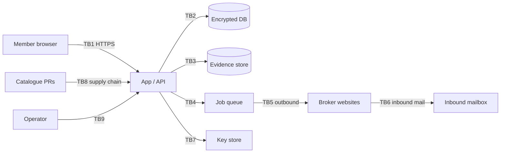

# Threat model

Scope: the `deletewe` hosted service and the self-hosted Docker image.
Method: asset-centric, with STRIDE applied to each trust boundary, plus a
section on harms the system could cause to people who are not its users —
which for a privacy product is the part that matters most.

## 1. Assets

| # | Asset | Why it is valuable to an attacker |
| --- | --- | --- |
| A1 | **Member profile** — name, aliases, full address history, phones, emails, DOB | A complete, verified identity dossier. More useful than any single broker record, because the member curated it |
| A2 | **Mandate / LPOA documents** | Authority to act as the member. Forgeable leverage over brokers |
| A3 | **Evidence blobs** | Screenshots of the member's broker listings — i.e. A1 again, in picture form |
| A4 | **Member DEKs / master key** | Decrypts everything |
| A5 | **Session cookies** | Full account takeover |
| A6 | **Inbound mailbox** | Receives broker confirmation links; controlling it lets an attacker complete or sabotage opt-outs |
| A7 | **Broker catalogue** | Supply chain: a malicious definition can exfiltrate PII to an attacker's endpoint |
| A8 | **Admin credentials** | Access to all members' operational data |

## 2. Adversaries

| Adversary | Capability | Motivation |
| --- | --- | --- |
| **Opportunistic attacker** | Internet access, scanners | Credential stuffing, bulk PII theft |
| **Targeted stalker** | Knows the victim; may be a current or former partner | Locate the victim. **This is the adversary the product exists to defeat, and the one for whom failure is physically dangerous** |
| **Malicious contributor** | Can open a PR to the catalogue | Exfiltrate PII via a crafted broker definition |
| **Hostile broker** | Controls pages we automate | Fingerprint us, serve a page designed to extract more profile data than needed, or poison our matcher |
| **Malicious operator** | Runs a hosted instance | Harvest members' dossiers |
| **Curious insider** | Legitimate admin access | Look up a specific person |
| **Legal compulsion** | Subpoena, warrant | Obtain a member's data |

## 3. Trust boundaries

## 4. STRIDE by boundary

### TB1 — Member ↔ App

| Threat | Mitigation |
| --- | --- |
| **S** Credential stuffing | argon2id/scrypt hashing, per-account and per-IP rate limits, breach-password check at signup, TOTP (v1), passkeys (v1) |
| **T** CSRF on destructive actions | SameSite=Lax + per-form CSRF token; account deletion requires re-authentication |
| **R** Member denies granting consent | `consent` and `mandate` are append-only with document hash, timestamp, and hashed IP/UA |
| **I** Session theft via XSS | Server-rendered UI, no `dangerouslySetInnerHTML`-equivalent on member data, strict CSP with no inline scripts, HttpOnly cookies |
| **D** Resource exhaustion via scans | Per-member job quotas |
| **E** IDOR into another member's listing | Every data-layer call takes `member_id` from the session, never from the request; a test asserts no repository method lacks it |

### TB2/TB3 — App ↔ storage

| Threat | Mitigation |
| --- | --- |
| **I** Database dump | All PII is ciphertext; the DB alone yields blind indexes and non-identifying metadata |
| **I** Blob store dump | Evidence encrypted with the member DEK |
| **T** Ciphertext transplanted between members | `member_id` bound as AES-GCM AAD; decryption fails |
| **I** Blind index enables confirmation attacks | Accepted and bounded: HMAC with a secret key, equality-only, truncated. An attacker with the DB but not the key cannot test guesses |
| **R** Evidence altered after the fact | Write-once keys, SHA-256 in `meta.json`, no update path in the repository layer |

### TB4/TB5 — Outbound to brokers

| Threat | Mitigation |
| --- | --- |
| **I** Over-disclosure: sending the full profile to every broker | **Minimum necessary disclosure.** The definition declares `required_fields`; the submitter is given a *projection* of the profile containing only those fields and physically cannot access the rest |
| **I** A broker page exfiltrates data | Navigation allowlist per definition; the browser session is ephemeral, cookie-less across brokers, and never carries member session state |
| **T** Broker serves a fake success page | Evidence captured and health-checked; `removed` requires a *subsequent re-scan finding nothing*, never a success page |
| **D** We DoS a broker | Per-broker concurrency, min interval, daily cap, circuit breaker |
| **R** Broker denies receiving the request | Full transcript + screenshot + timestamp retained as evidence |
| — **Legal/ethical** | No CAPTCHA solving, no access-control bypass, no authenticated scraping, honest User-Agent |

### TB6 — Inbound mail

| Threat | Mitigation |
| --- | --- |
| **S** Forged "confirmation" email | Per-job, high-entropy inbound address; sender domain checked against the definition's `verification.expected_senders`; SPF/DKIM result required |
| **T** Attacker-supplied link followed blindly | Followed links must match the definition's `link_pattern` **and** resolve to an allowlisted host. Everything else becomes an operator review item |
| **I** Mailbox contents leak PII | Messages stored as encrypted evidence, parsed and then discarded |
| **E** Email-triggered job injection | The inbound address maps to exactly one job; the message cannot name a different job |

### TB7 — Key store

| Threat | Mitigation |
| --- | --- |
| **I** Master key in the repo or a log | Secret bindings only; `.dev.vars` gitignored; a CI secret scanner |
| **E** Key reuse across environments | Keys are per-environment and versioned; a dev key cannot decrypt prod ciphertext |
| **D** Key loss destroys all data | Documented key-backup procedure for self-hosters; this is a real and accepted risk of encrypting properly |

### TB8 — Catalogue supply chain

This is the highest-leverage attack on an open project and gets the most
structural mitigation.

| Threat | Mitigation |
| --- | --- |
| **I** Malicious definition posts the profile to attacker.example | Definitions are **declarative data, not code**. There is no `eval`, no scripting hook, no arbitrary request builder. Every host a definition can reach must appear in its `hosts` allowlist, and the schema validator rejects a definition whose steps reference a host not in that list |
| **I** Definition requests fields it does not need | `required_fields` is schema-constrained to a closed enum and is reviewed; the submitter only ever receives the declared projection |
| **T** Definition silently changed after review | `definition_sha256` recorded on every job and on every piece of evidence; drift is detectable |
| **E** Step actions escalate (e.g. file upload) | The action enum is closed: `goto`, `fill`, `select`, `click`, `wait_for`, `expect`, `extract`, `screenshot`, `handoff`. No file upload, no script execution, no download. `handoff` is the only way a definition can ask for human involvement, and it ends the automated run |
| — | CODEOWNERS review required on `packages/catalog/brokers/**` |

### TB9 — Operator

| Threat | Mitigation |
| --- | --- |
| **I** Curious insider looks up an individual | Admin UI shows **no decrypted member PII by default** — cases are identified by id and broker. Decryption requires an explicit break-glass action with a typed reason, written to `admin_audit`, and surfaced to the member in their own event log |
| **R** Operator denies acting | Append-only `admin_audit` |
| **E** Admin role creep | Separate `admin_user` table, no shared accounts, separate session cookie scope |

## 5. Harms to non-users

A privacy product can hurt people who never signed up. Three specific risks:

### 5.1 The product becoming a people-search tool

**Risk:** the scan engine is, mechanically, a multi-broker person lookup. If it
can be pointed at an arbitrary name, we have built the thing we are fighting.

**Mitigations, structural rather than policy:**
- the profile is 1:1 with the authenticated member; there is no "subject"
  parameter anywhere in the API;
- scan jobs take a `member_id`, derive the profile server-side, and have no
  way to accept arbitrary search terms;
- scan results are written only to that member's rows and are never returned
  to any other caller;
- **no search endpoint exists** — results are only ever rendered within the
  owning member's session;
- a test asserts that the scan use-case rejects any input not derived from a
  stored profile.

### 5.2 Third-party data in profiles

Relatives' names are a strong match signal, and brokers display them. But they
are personal data about people who have not consented.

**Decision:** relatives are **not** a profile field. The matcher may use a
relative name *appearing in a fetched listing* as evidence that the listing
concerns the member, but we do not store a relatives list, never submit a
relative's name to a broker, and the member cannot enter one. Household
addresses are stored as the member's own address, which they are.

### 5.3 False-positive submissions

**Risk:** a bad match causes us to send a *stranger's* listing data, labelled as
our member's, to a broker — exposing one person's data to a third party, under a
false claim of authority.

**Mitigations:** the consent gate (no submission without a confirmed match);
conservative default thresholds; `require_manual_confirmation` on ambiguous
brokers; minimum-necessary projection limiting what a bad match can leak; every
rejection recorded and used to tune the broker's weights.

## 6. Logging

A dedicated control, because it is where PII leaks in practice.

- Structured logging only, through one redacting logger.
- The logger's type signature accepts a closed set of safe fields: ids,
  enum codes, durations, counts, broker slugs. **Profile values are not
  representable in the log API.**
- Error paths log an `error_code` plus a redacted detail string; exception
  messages from the browser driver and mail parser are scrubbed against the
  member's own field values before being stored.
- A unit test seeds a profile with sentinel values and asserts none of them
  reaches the log sink across a full pipeline run.
- No third-party error reporter or analytics SDK is installed.

## 7. Accepted risks

Stated plainly rather than hidden:

| Risk | Why accepted |
| --- | --- |
| A hosted operator can, with effort and an audit trail, decrypt a member's data | Unavoidable for a hosted service that must act on the data. Mitigated by audit + break-glass + the existence of self-hosting |
| Blind indexes permit confirmation of a guessed value *if* the index key leaks | The alternative is no lookup at all; key is separate from the master key |
| Key loss is unrecoverable | Correct consequence of real encryption |
| We cannot guarantee a broker honours a request | Inherent. Mitigated by re-checking and honest reporting |
| Self-hosters may misconfigure | Mitigated by secure defaults, a startup preflight check that refuses to boot with a default key, and documentation |

## 8. Residual high-severity items for human review

- Legal review of the mandate/LPOA instruments (see
  [research/05-legal-basis.md](research/05-legal-basis.md)).
- A real penetration test before any hosted launch.
- Threat modelling of the postal/fax provider once chosen — that vendor sees
  name and address in plaintext by necessity.
- Jurisdictional analysis of processing EU members' data on US infrastructure.
